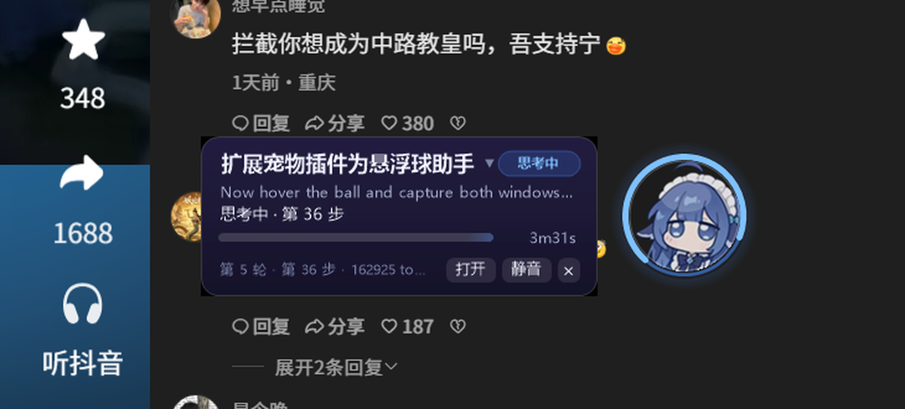
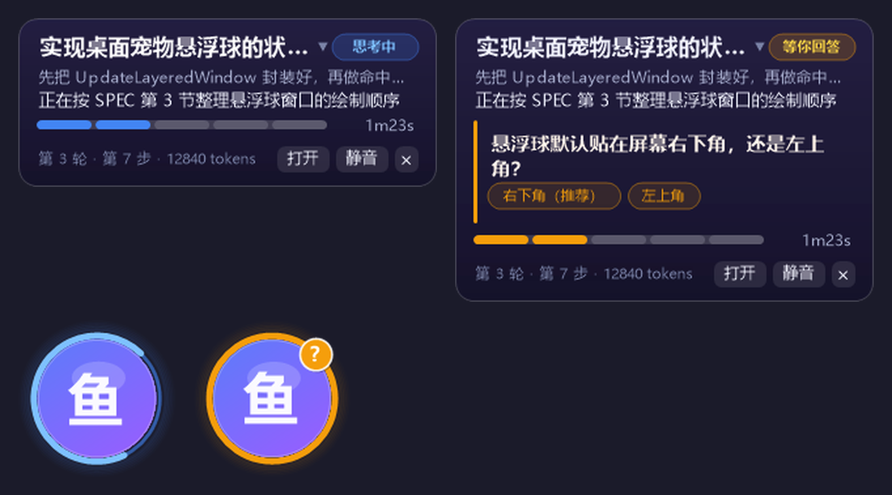
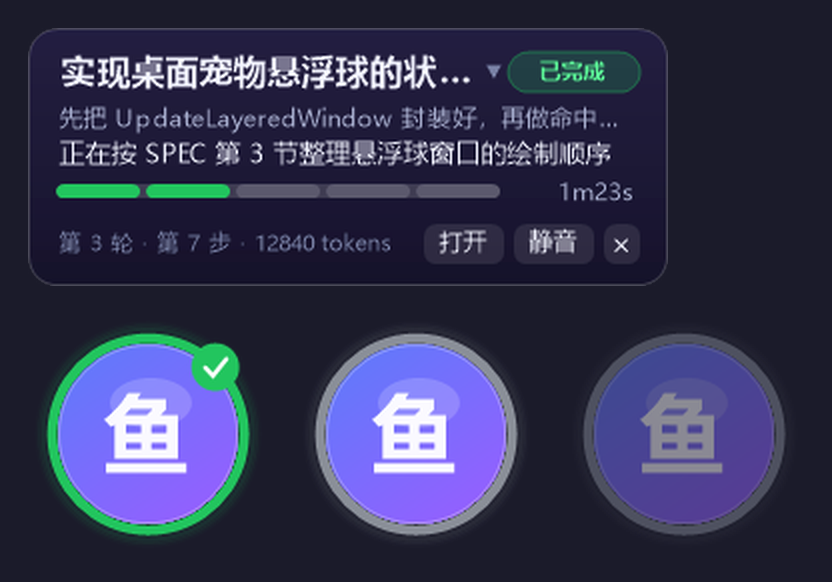

# dsh-pet-float

> Turn the DeepSeek Harness pet into a desktop floating ball: always-on-top ball, music-player-style status panel, "啊" when the session needs you, one click back to the conversation. · 把 DSH 的宠物变成桌面悬浮球。



## What it does / 这是干嘛的

DeepSeek Harness runs long turns. When you alt-tab away you cannot tell whether the agent is still working, waiting for an answer, or done — the pet only exists inside the DSH window.

This plugin puts a small character ball on top of your desktop and keeps it honest about the session:

- **Always-on-top ball** (120 px, per-pixel alpha, click-through on the transparent pixels) you can drag anywhere; the position is remembered.
- **Hover → status panel**, styled like a music player: session title, a status chip (思考中 / 调用工具 / 等你回答 / 等你授权 / 本轮结束 / 出错 / 离线), the one-line thinking summary of the running step, the current question with its options when the agent asks you something, a segmented progress bar, elapsed time, round · step · token count.
- **"啊" only when it matters**: a short alert sound on *needs you* (a question, an approval request) and on *turn finished*. Nothing while idle, nothing while the turn is just running normally. Every alert fires once per event, so it does not repeat.
- **Click the ball → DSH comes to front** and switches to that session.
- **Tray icon** with open / hide / mute / quit, and an optional start-with-Windows entry.

| 正在运行 | 等你回答 |
| --- | --- |
|  | |



## Requirements / 环境

- **Windows 10 / 11** (the ball is a Win32 layered window; the panel is drawn with GDI+).
- **DeepSeek Harness** with the desktop app (Electron) or a web profile on the same machine. Developed against DSH 0.2.x.
- .NET Framework 4.8 — already part of Windows 10/11, so the bundled `DshPetFloat.exe` runs without installing a runtime or an SDK.

## Install / 安装

Install it into a DSH profile:

```sh
dsh plugin --profile web add github:TUJUplayer/dsh-pet-float
```

The CLI refuses `--profile desktop` (the desktop app owns that profile), so if you use the desktop app, install the same package from your plugin market UI, or let it manage the desktop profile for you. Either way, **restart DSH** afterwards — the host plugin is loaded at startup. On the first run it copies the companion `DshPetFloat.exe` and the default avatar/sound into `%USERPROFILE%\.dsh\dsh-pet\`, so there is no second install step.

If you would rather install a prebuilt tarball than build from a git checkout, the release asset works too:

```sh
dsh plugin --profile web add "https://github.com/TUJUplayer/dsh-pet-float/releases/latest/download/dsh-pet-float.tgz"
```

## Usage / 用法

| 操作 | 结果 |
| --- | --- |
| 悬停小球 | 弹出状态面板（鼠标移开约 0.6 s 收起） |
| 单击小球 | 把 DSH 窗口提到最前，并切到面板里显示的那个会话 |
| 拖动小球 | 移动位置，松手后记住（写入 `%APPDATA%\dsh-pet\config.json`） |
| 右键小球 / 托盘图标 | 菜单：打开 DSH、显示/隐藏、静音、开机自启、退出 |
| 面板上的「打开」 | 同单击 |
| 面板上的「静音」 | 关掉提示音（仍保留状态显示） |
| 面板上的「×」 | 本次收起面板 |

状态环颜色：蓝=思考中、青=调用工具、橙=等你回答/授权、绿=本轮结束、红=出错、灰=离线。

## When it makes a sound / 什么时候会"啊"

| 事件 | 是否提示 |
| --- | --- |
| 项目还没开始 / 空闲 | 不提示 |
| 正常跑（思考、调用工具） | 不提示 |
| Agent 向你提问（`ask_user_question`） | **啊一声** |
| 请求授权 | **啊一声** |
| 一轮结束 | **啊一声** |
| 出错 | **啊一声** |

每条事件只响一次（按事件 id 去重），冷启动不会把历史事件补播一遍。

## Customize / 自定义

- 换形象：把图片放到 `%USERPROFILE%\.dsh\dsh-pet\avatar.png`（正方形、透明底最好，512 px 起）。
- 换提示音：`%USERPROFILE%\.dsh\dsh-pet\sound.wav`。
- 也可以用环境变量 `DSH_PET_AVATAR` / `DSH_PET_SOUND` 直接指到任意路径。
- 行为开关在 `%APPDATA%\dsh-pet\config.json`：`{ "posX": -1, "posY": -1, "scale": 1, "soundOn": true, "endSoundOn": true, "clickOpens": true, "hidePanelMs": 600, "autoStart": false }`（`-1` 表示默认屏幕右下角）。

## How it works / 实现方式

两个进程，一个状态文件：

1. **宿主插件** (`lib/index.js`, `lib/pet.mjs`) 跟着 DSH 的 host 进程跑，订阅 `session/event`、`agent/assistant-stream`，把当前会话的状态（标题、状态、思考摘要、问题与选项、轮次/步数/token、待处理事件）合并成快照，每 200 ms 增量写一次 `%USERPROFILE%\.dsh\.dshp-state.json`；变化时追加事件，供伴侣去重播放提示音。
2. **桌面伴侣** (`DshPetFloat.exe`, C# WinForms + GDI+，源码在 `companion/`) 由插件拉起，轮询状态文件画球与面板；点击后写 `%USERPROFILE%\.dsh\.dshp-cmd.json`。
3. **页面桥** (`assets/pet-bridge.js`) 由插件注入 DSH 页面：因为会话切换是 React state、没有 URL 路由，桥用 `[class*="_sessionRow"]` / `[class*="_title"]` 找到会话行并点击，同时把 DOM 里的思考摘要与标题回传给插件，作为宿主侧拿不到时的补充。

设计上刻意不走网络：DSH 的 HTTP 路由要求浏览器 cookie 鉴权（launch token 换签），外部进程换不到，所以状态用一个原子写入的文件传递，也顺手解决了页面被遮挡时节流的问题。

## Uninstall / 卸载

```sh
dsh plugin --profile web remove dsh-pet-float
```

再删掉 `%USERPROFILE%\.dsh\dsh-pet\`、`%APPDATA%\dsh-pet\` 和 `%USERPROFILE%\.dsh\.dshp-*.json` 即可（可留作配置）。

## Troubleshooting / 排障

| 现象 | 处理 |
| --- | --- |
| 装完没有小球 | 先确认 DSH 已重启；看 `%APPDATA%\dsh-pet\log.txt`，以及 `%USERPROFILE%\.dsh\.dshp-state.json` 是否在刷新 |
| 小球出现但一直是灰色 | 宿主插件没写状态：确认插件在 profile 的 `dsh.profile.bundles` 里 |
| 悬停不出面板 | 指针要落在球心附近（球的透明边缘会让点击穿透，属正常） |
| 点球没切会话 | 页面桥没注入：完整重启 DSH（关窗回托盘再打开），桥只在页面加载时注入 |
| 没声音 | 面板「静音」开关、`config.json` 的 `soundOn`，或 `sound.wav` 损坏 |
| 球跑到屏幕外了 | 删掉 `%APPDATA%\dsh-pet\config.json` 里的 `posX/posY`，或把两者改成 `-1` 后重启伴侣 |

## License / 许可

MIT。自带默认素材（`assets/pet.png`、`assets/ah.wav`）由 `scripts/gen-assets.py` 生成并以 CC0 1.0 发布，详见 [NOTICE.md](NOTICE.md)。
